# ScrollMotion Skill

A clean-room library of 20 expressive UI components and 20 scroll/motion/background recipes for AI coding agents. Inspired by the broad motion-design category represented by Scrolltide; no paid source or prompts are reproduced.

> Status: All four implementation phases are present. Each inventory entry links to its authored PNG preview in `assets/previews/`.

## Components

| Preview | Component | Description |
|---|---|---|
| 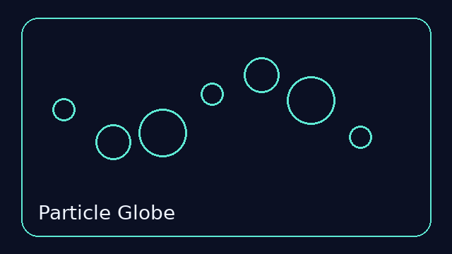 | Particle Globe | Interactive point-sphere rotates with pointer drag and proximity glow. |
| 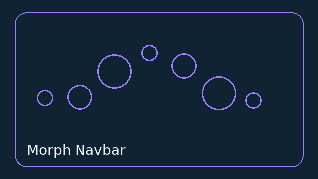 | Morph Navbar | Navigation capsule changes silhouette and density as the page scrolls. |
| 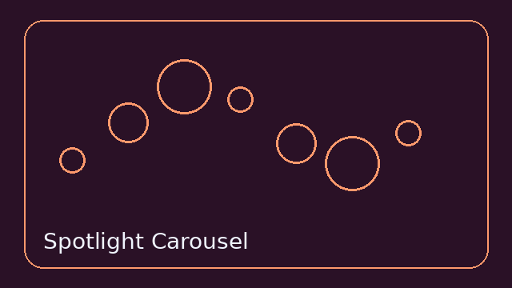 | Spotlight Carousel | Active card receives a focused pool of light. |
| 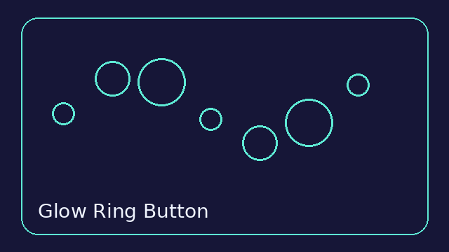 | Glow Ring Button | Cursor-tracking luminous ring around a focused action. |
| 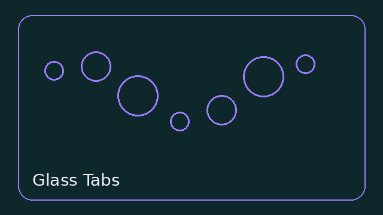 | Glass Tabs | Frosted tabs with a sliding active indicator. |
| 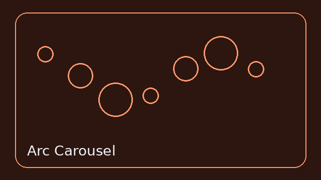 | Arc Carousel | Cards rotate through a shallow cinematic arc. |
| 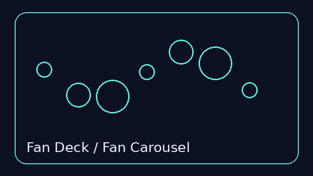 | Fan Deck / Fan Carousel | Fanned cards spread and elevate on interaction. |
| 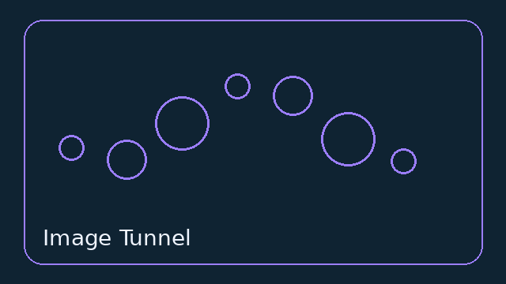 | Image Tunnel | Image planes recede through a scroll-controlled depth tunnel. |
| 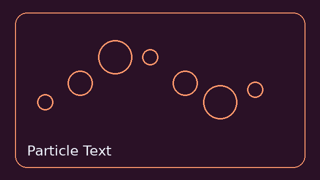 | Particle Text | Letterforms assemble from points and scatter on hover. |
| 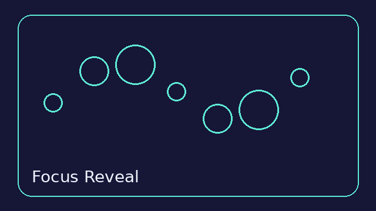 | Focus Reveal | Sentence resolves from soft blur to crisp focus word by word. |
| 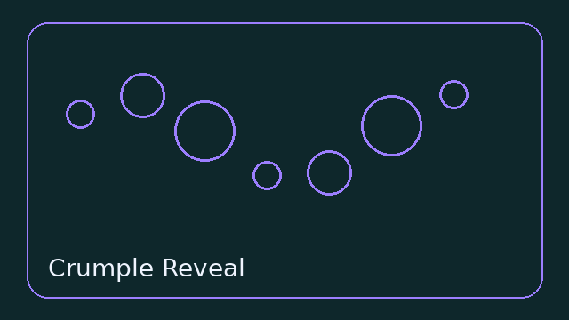 | Crumple Reveal | Content unfolds from a paper-like compressed state. |
| 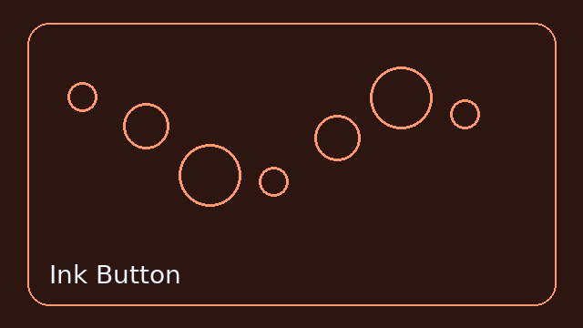 | Ink Button | Organic ink wash fills an accessible action button. |
| 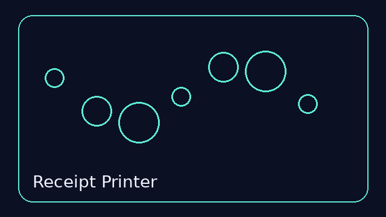 | Receipt Printer | Receipt content prints into view line by line. |
| 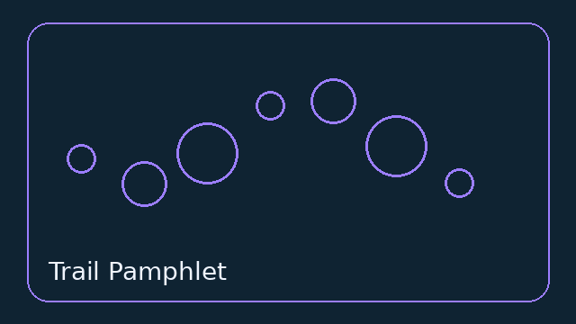 | Trail Pamphlet | Folded panels open in sequence with a trailing motion. |
| 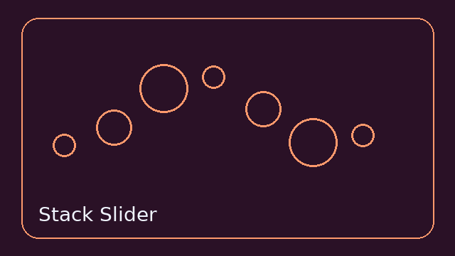 | Stack Slider | Layered cards advance through a depth stack. |
| 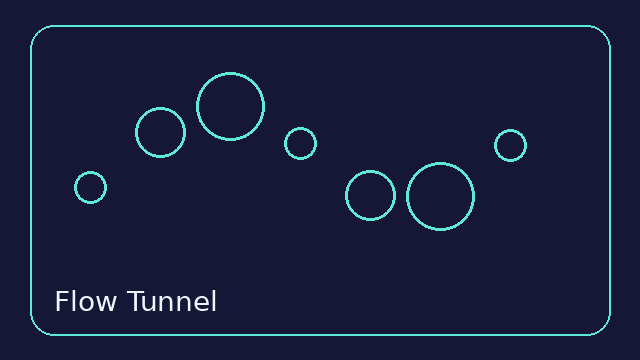 | Flow Tunnel | A flowing depth passage connects neighboring sections. |
| 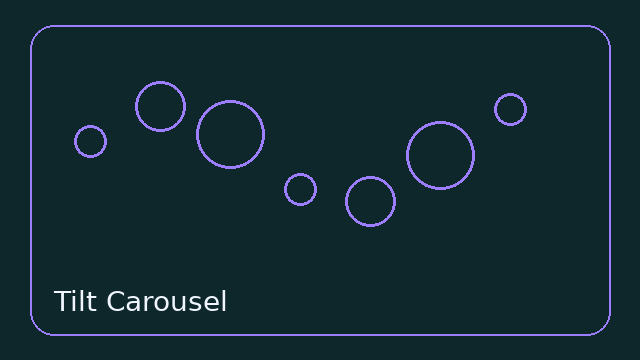 | Tilt Carousel | Cards tilt subtly toward pointer or device orientation. |
| 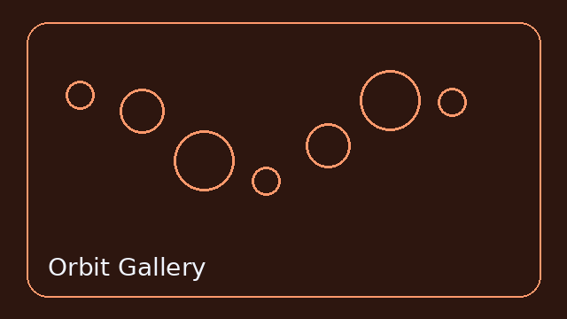 | Orbit Gallery | Gallery items circle a central focal point. |
| 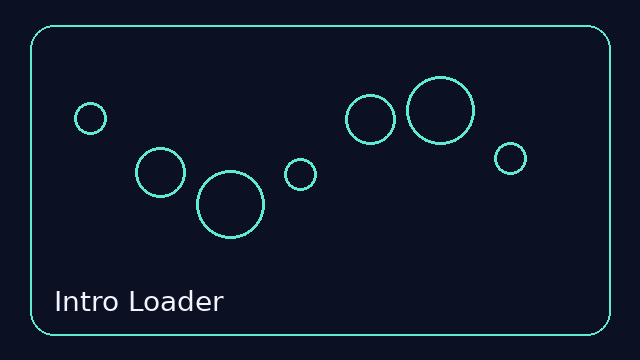 | Intro Loader | Progress cue transitions into a restrained content reveal. |
| 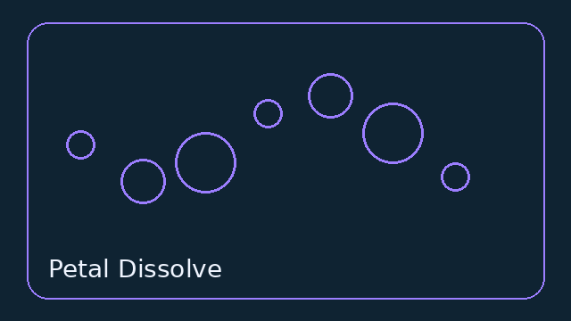 | Petal Dissolve | Petal-like fragments disperse to reveal the next scene. |

## Animations and shader backgrounds

| Preview | Animation | Description |
|---|---|---|
| 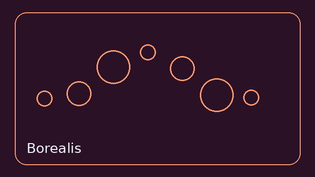 | Borealis | Layered aurora ribbons drift across a dark sky. |
| 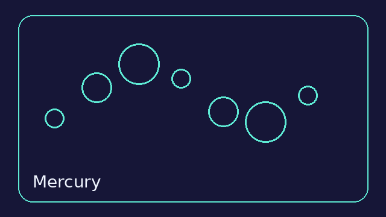 | Mercury | Reflective liquid-metal surface ripples like chrome. |
| 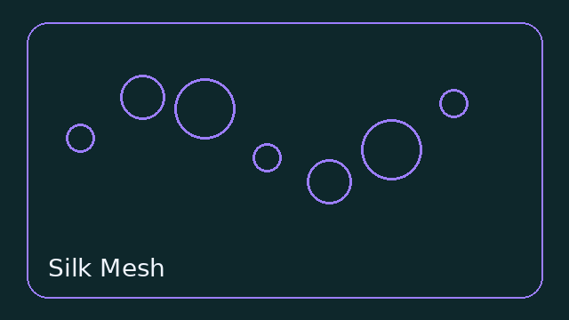 | Silk Mesh | Soft animated mesh-gradient color fields. |
| 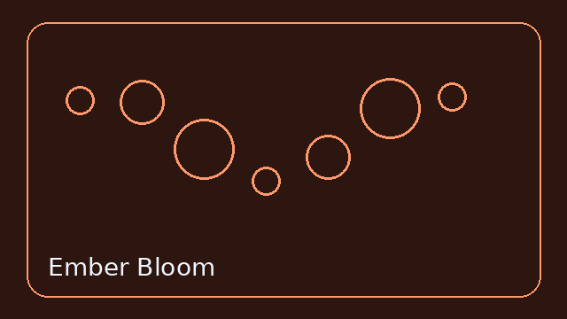 | Ember Bloom | Warm ember-like flame blooms over a dark field. |
| 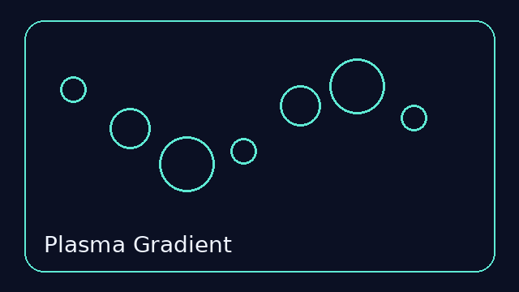 | Plasma Gradient | Fluid, saturated plasma colors flow across the canvas. |
| 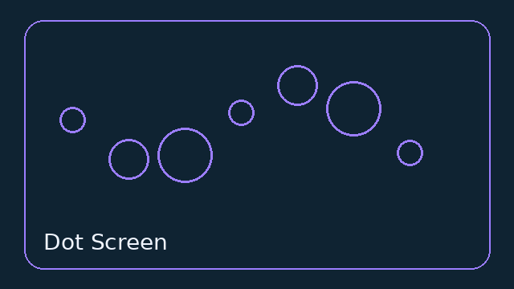 | Dot Screen | Halftone dots modulate light and shadow. |
| 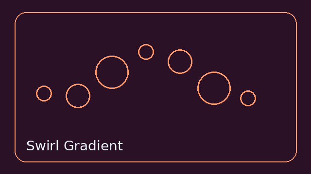 | Swirl Gradient | Vortex-shaped gradient turns around a soft focal point. |
| 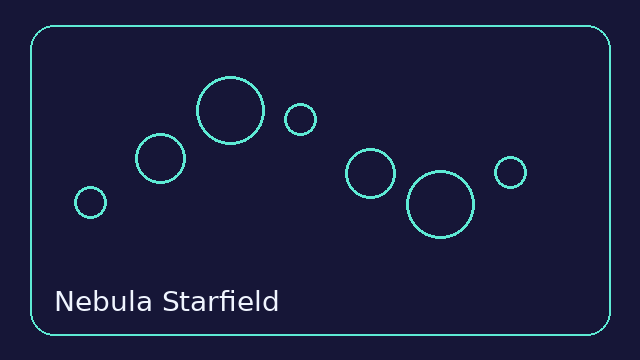 | Nebula Starfield | Sparse stars sit within a clouded nebula field. |
| 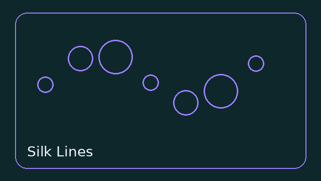 | Silk Lines | Fine luminous wave lines ripple like woven fabric. |
| 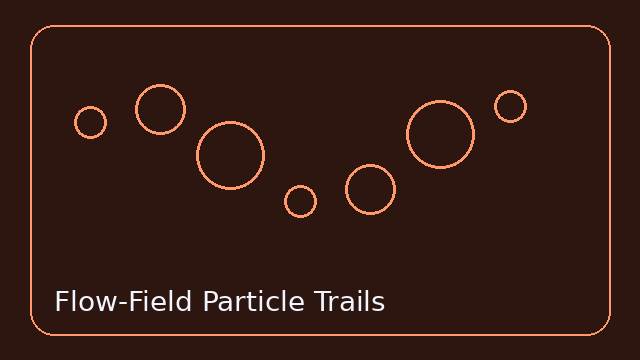 | Flow-Field Particle Trails | Particles trace directional currents through space. |
| 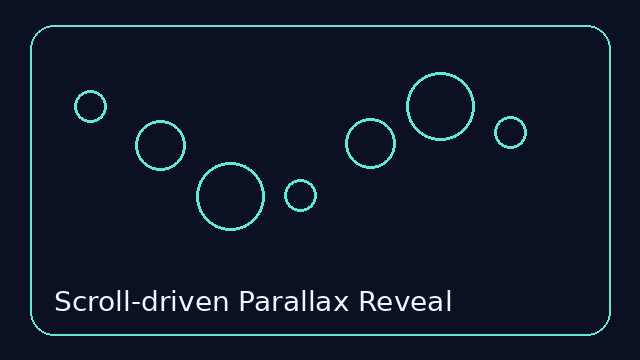 | Scroll-driven Parallax Reveal | Layered content separates gently as it enters view. |
| 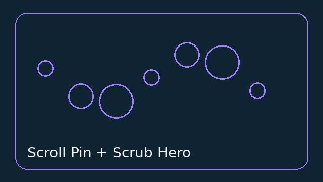 | Scroll Pin + Scrub Hero | Pinned hero progresses in sync with scroll position. |
| 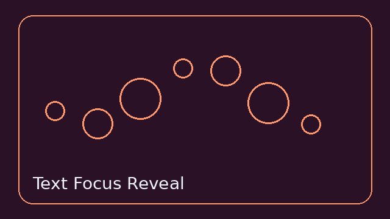 | Text Focus Reveal | Scrolling sharpens blurred text progressively. |
| 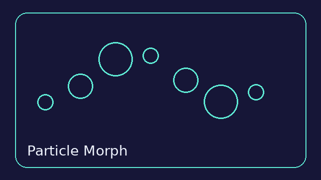 | Particle Morph | Point cloud transitions between typed shapes. |
| 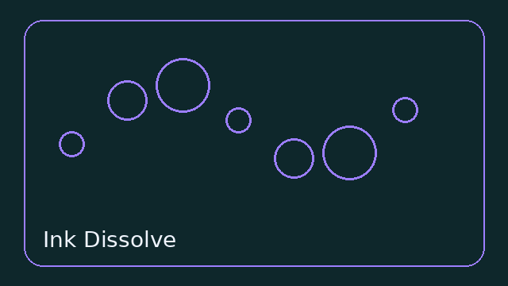 | Ink Dissolve | Ink-like mask spreads to transition between states. |
| 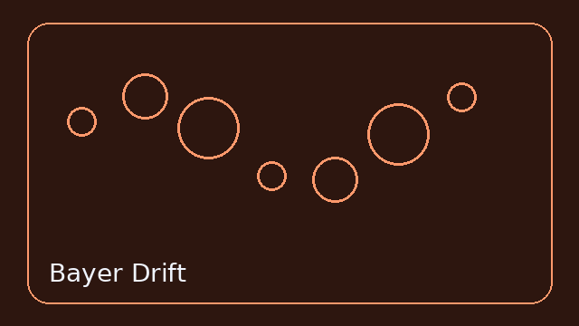 | Bayer Drift | Dither pattern drifts under restrained film grain. |
| 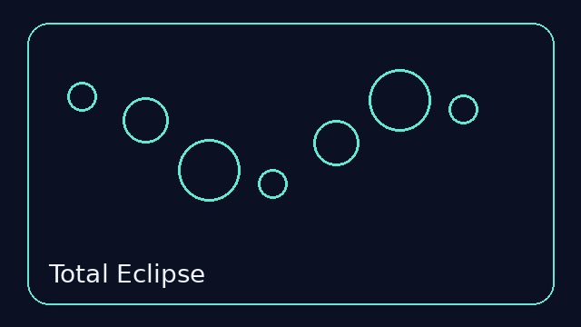 | Total Eclipse | Dark disc and volumetric rays create an eclipse scene. |
| 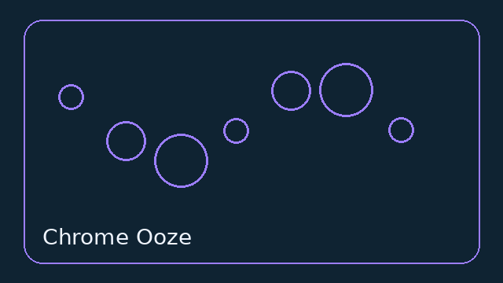 | Chrome Ooze | Metallic metaball forms merge and separate. |
| 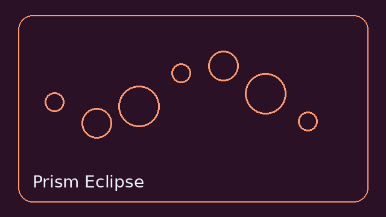 | Prism Eclipse | Conic spectrum arcs around a dark eclipse core. |
| 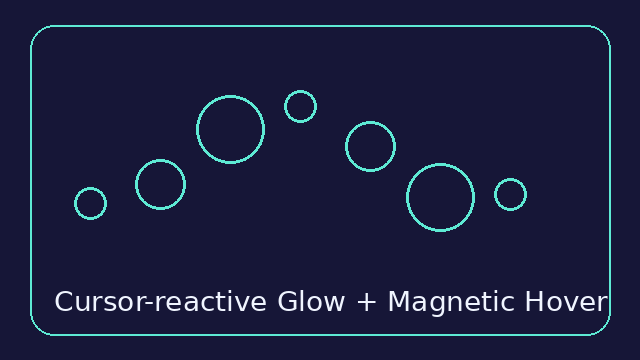 | Cursor-reactive Glow + Magnetic Hover | Local glow and restrained magnetic response follow the pointer. |

## Structure

`components/<kebab-name>/Component.tsx` + local styles and README; `animations/<kebab-name>/Animation.tsx`, optional `shader.glsl`, styles and README; `assets/previews/<kebab-name>.png`; and `demo/` for the interactive Vite showcase. See [SKILL.md](SKILL.md) for agent instructions and validation criteria.

## Development

```sh
npm install
npm run dev
npm run typecheck
npm run build
```
